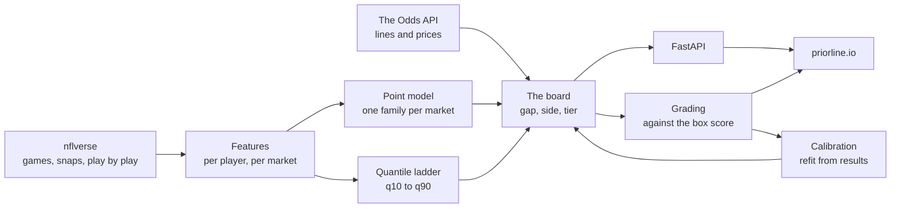

<p align="center">
  <a href="https://priorline.io">
    
  </a>
</p>

<p align="center">
  <a href="https://priorline.io"></a>
  <a href="https://priorline.io/record"></a>
  <a href="https://priorline.io/model"></a>
</p>

<p align="center">
  
  
  
  
  
  
  
  
  
  
  <a href="https://github.com/seidcubro/player-prop-machine-learning-analysis-platform/actions/workflows/ci.yml"></a>
</p>

---

I built this to answer one question before I bet: **is this line wrong?**

PriorLine pulls every NFL player prop the books are offering, projects what the
player will do, and shows the gap between my number and theirs. Every pick is
then graded against the price it was offered at, and the whole record is
posted, including the parts written in red.

It runs by itself. Five timers on one server ingest the games, rebuild the
features, retrain eleven models a week, price the board, grade the results and
audit their own freshness.

| | |
|---|---|
| **11** markets modelled | passing, rushing, receiving, touchdowns |
| **12,000+** picks graded | each one against the price it was offered at |
| **5** seasons of game data | 2022 to now, play by play |
| **1** person | design, models, API, site, server |

## How it works



- **Ingestion** reads nflverse: box scores, snap counts, depth charts, injuries
  and play by play.
- **Features** are built per player per market: rolling production, role,
  play context, the opposing defense against his position, the game and the
  venue.
- **Models**: one point model per market, its family chosen by a walk-forward
  bakeoff, plus five quantile models that give the shape of the outcome.
- **The board** prices each projection against the best line on offer, picks a
  side from the median, and ranks picks within each market.
- **Grading** settles every pick against the box score at the price it was
  posted at. The calibrators are refitted from those results.
- **The audit** runs last and fails the build if anything is stale.

## Does it work?

Honest answer: not yet in the way the pitch sounds, and the site says so.

The head-on version, project every player and bet wherever I disagree with the
book, loses. I trained on 2022 through 2024, ran the whole 2025 season blind
and graded 6,736 picks against real lines: 51.5% right where the prices needed
53.9%.

This season, under the rules the board uses today, replayed week by week on
only what was known at the time (weeks 1 to 11, as of 22 November 2026):

| Tier | Picks | Right | Prices needed |
|---|---|---|---|
| Elite | 321 | 57.9% | 58.9% |
| Strong | 321 | 60.4% | 63.1% |
| Medium | 321 | 53.6% | 58.0% |

Elite led its price through week 5 and has trailed it since. The live numbers
are at [priorline.io/record](https://priorline.io/record), and they move every
week.

What I have learned so far, each one the hard way:

- **I could not out-predict the market on yardage.** Neither could a model
  handed the market's own number. Better projections there did not turn into
  better picks.
- **Books shade props toward the over**, and more so on big names. A model
  that predicts the mean reads over-value on nearly every prop, because a line
  sits at the median and yardage is skewed.
- **Calibration matters more than accuracy.** Probabilities that ran 14 to 29
  points hot made every edge on the board look bigger than it was.
- **The game log lied by omission.** A player who took the field and recorded
  nothing had no row at all, one game in eight, so the model had never seen a
  blank game. That was fixed on 22 November 2026.

The full method, every model and every idea I tested and threw out is in
[docs/MODEL.md](docs/MODEL.md) and on the site at
[priorline.io/model](https://priorline.io/model).

## Engineering I am proud of

<details>
<summary><b>Model selection that refuses noise</b></summary>

<br>

The obvious approach is to try a few models and keep whichever wins on a test
split. With ten candidates and one split, one of them wins by luck.

So every candidate is scored on the same expanding-window folds: train on
everything before a cut, test on the block after it, walk the cut forward. A
challenger replaces the incumbent only if it beats it by more than one standard
error of the fold-to-fold difference. The last run took four changes and
refused three where the gain was inside the noise.

Two results I did not expect. Linear models won three markets: ridge beats
every tree on rush attempts, and elastic net wins rushing yards and receptions.
And LightGBM lost everywhere, with train-minus-test gaps of 0.34 to 0.51. It
was memorising, and the bakeoff prints that gap for every candidate, which is
what caught it.

| Market | Family |
|---|---|
| rush_att | ridge |
| rush_yds, recs | elastic net |
| rec_yds | random forest |
| pass_yds, pass_att, pass_completions | histogram gradient boosting |
| pass_td | poisson |
| rush_td, rec_td, any_td | random forest, scored as classifiers |

The active model per market lives in a table, so this is a snapshot.

</details>

<details>
<summary><b>A freshness audit that tests instead of trusting</b></summary>

<br>

Anything known before kickoff (depth chart, injuries, the line, weather, the
opponent) used to be read off the player's most recent stored feature row. In
season that row is a week old. In September it is eight months old, and you get
a back projected as the starter he was last January.

Houston traded for David Montgomery over the offseason. My own depth chart had
it right, and the board was still projecting the man he replaced as the
workhorse. Three more turned up when I went looking: opponent features that
described the defenses a player had just faced and not the one he was about to
play, traded players dropped silently by the check written to catch them, and
two team codes that never matched.

All of it is enforced now. The audit seeds every feature with a sentinel value,
runs the refresh against a real upcoming game, and looks at what changed. My
first version read the source with a regex and was wrong both ways.

```bash
docker compose run --rm training python audit_freshness.py
```

It exits non-zero if any of it comes back.

</details>

<details>
<summary><b>Probabilities read off a learned distribution</b></summary>

<br>

The number beside a projection matters more than the projection. It used to
come from a bell curve with a hand-capped standard deviation, which produced
95% confidence on a rushing prop.

Now five quantile models per market give the shape of the outcome, so the
spread is learned per player. A boom-or-bust receiver gets a wide interval and
a steady possession back a narrow one. A calibration map fitted on past
results corrects the level, and the published probability is corrected per
side using the model's number and the price together.

On unders the model's confidence predicts hits. On overs the weight comes out
negative: once you know the price, a more confident over is slightly less
likely to land. Overs stay on the board with an honest number beside them.

</details>

<details>
<summary><b>A Monte Carlo that got teammates right when I had them wrong</b></summary>

<br>

Every market used to be predicted alone, so a quarterback's passing yards had
no arithmetic relationship to the receiving yards of the men catching the
ball. `simulate.py` runs 20,000 games per matchup and reads every market off
the same simulated outcomes: team volume from the Vegas total and spread,
shares split so touches sum to the team total, and the quarterback's yards
derived as the sum of his receivers'.

| | Simulated | Real |
|---|---|---|
| QB pass yards vs lead receiver | +0.510 | +0.697 |
| WR1 vs WR2 receiving yards | -0.001 | +0.041 |

I expected teammates to correlate strongly negative, since they compete for
targets. They do not. Shared team volume pushes them together, target
competition pushes them apart, and in real games those cancel almost exactly.

</details>

<details>
<summary><b>News that beats the feed</b></summary>

<br>

The injury feed is the official Wednesday to Friday report, so nothing that
breaks after it reaches the board in time. Puka Nacua was ruled out of a Monday
game while the site still projected him for six receptions.

Three things close that gap. The hourly refresh re-reads injuries and depth
charts before it rebuilds. A prop a book has taken down drops off the board.
And I can rule a player out directly, which beats the feed until it expires:

```bash
curl -X POST -H "X-Admin-Token: $ADMIN_TOKEN" \
  "http://localhost:8000/api/v1/jobs/player_status?player=Puka%20Nacua&status=Out&hours=24"
```

When a starting quarterback is ruled out, his backup inherits the workload.
Running backs and receivers were tested the same way and refused.

</details>

## In season

Five systemd timers run `scripts/scheduled_update.sh` in different modes
(Eastern time):

| When | Mode | Does |
|---|---|---|
| hourly at :05 | `--closing` | if a game kicks off within 90 minutes, buy its prices and rebuild the board |
| daily 8:00 | `--daily` | ingest results, rebuild features, grade picks, refit calibration |
| daily 17:00 | `--board` | fresh injury reports, projections and the board |
| Fri 9:00 | `--early` | price Sunday's slate so the board is live from Friday |
| Tue 1:00 | `--weekly` | retrain every market after Monday night is graded |

Setup is in [deploy/README.md](deploy/README.md) and the modes are explained in
[scripts/README.md](scripts/README.md).

## Running it

```bash
docker compose up -d postgres
docker compose build api training
docker compose up -d api
npm run dev --prefix apps/web
```

Model artifacts are not in git. The weekly mode regenerates them:

```bash
sh scripts/scheduled_update.sh --weekly
```

Prices come from The Odds API, which bills per event per market, so a manual
run buys none unless it is asked to (`ODDS=1`).

## Layout

| Path | What is in it |
|---|---|
| [`services/training/`](services/training/) | training, bakeoff, the board, grading, calibration, the audits |
| [`services/api/`](services/api/) | FastAPI backend and the feature builder |
| [`jobs/ingestion/`](jobs/ingestion/) | the nflverse pipeline |
| [`apps/web/`](apps/web/) | React frontend |
| [`db/`](db/) | schema and migrations |
| [`scripts/`](scripts/) | the scheduled refresh and its modes |
| [`deploy/`](deploy/) | production compose, Caddy, systemd timers |
| [`docs/`](docs/) | architecture, the model, the pipeline, the data analysis |

Start with [docs/MODEL.md](docs/MODEL.md) for the method,
[docs/ARCHITECTURE.md](docs/ARCHITECTURE.md) for how the pieces fit, and
[docs/eda/FINDINGS.md](docs/eda/FINDINGS.md) for what is in the data.

## Author

**Seid Cubro**

<a href="https://www.linkedin.com/in/seid-cubro"></a>
<a href="https://seidcubro.vercel.app"></a>

<sub>21+. Projections, not betting advice. Gambling problem? Call 1-800-GAMBLER.</sub>
